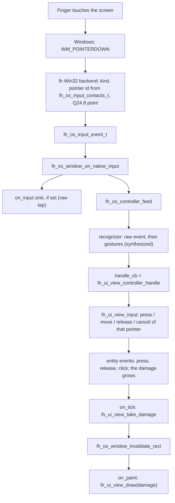

# The lh user interface: one guide for every screen

This guide explains how to build a user interface with lh, on any of its three
targets: a window on a desktop computer, a small screen on a microcontroller,
and a browser tab. It also tells the story of the input work done on
2026-10-17: one kind of event for every touch, click and key, one "dispatcher"
that decides what a gesture means, several fingers at once, and real touch on
Windows.

You do not need to be an expert to read it. When a technical word appears for
the first time, it is explained right there.

---

## Contents

1. [A short story: many languages, one language](#1-a-short-story-many-languages-one-language)
2. [The big picture](#2-the-big-picture)
3. [Adding lh to a project](#3-adding-lh-to-a-project)
4. [Building the screen: the UI tree](#4-building-the-screen-the-ui-tree)
5. [Drawing: the view, the canvas and the damage](#5-drawing-the-view-the-canvas-and-the-damage)
6. [Input: one event for everything](#6-input-one-event-for-everything)
7. [The sink: one door for all events](#7-the-sink-one-door-for-all-events)
8. [The controller: the dispatcher](#8-the-controller-the-dispatcher)
9. [Several fingers at once](#9-several-fingers-at-once)
10. [Touch on Windows](#10-touch-on-windows)
11. [Recipe: a desktop application](#11-recipe-a-desktop-application)
12. [Recipe: a microcontroller with a screen](#12-recipe-a-microcontroller-with-a-screen)
13. [Recipe: the same application in a browser](#13-recipe-the-same-application-in-a-browser)
14. [How it works inside](#14-how-it-works-inside)
15. [The touch lab](#15-the-touch-lab)
16. [Finding problems](#16-finding-problems)
17. [What is not done yet](#17-what-is-not-done-yet)
18. [Overlap with the usage guides](#18-overlap-with-the-usage-guides)

---

## 1. A short story: many languages, one language

Imagine a hotel reception desk. Guests arrive from many countries. One speaks
French, one speaks Japanese, one only points with a finger. If every hotel
worker had to learn every language, nothing would get done. So the hotel puts
one interpreter at the door. The interpreter listens to each guest and writes
every request on the same small form, in one language. Behind the desk,
people only read forms.

Computers have the same problem with input. Windows tells a program "the left
mouse button went down at x=120, y=45" with one kind of message
(`WM_LBUTTONDOWN`), and a finger on a touch screen with another
(`WM_POINTERDOWN`). Linux with X11 says `ButtonPress`. A browser says
`pointerdown`. A touch chip on a microcontroller just raises a pin and gives
two numbers.

Before today, lh passed some of these differences on to the application: a
separate window callback for press, for move, for release, for the wheel, for
keys, for text, and even one for "click". The web host had its own set. A
microcontroller called yet other functions.

Today lh got its interpreter. Every backend (a "backend" is the part of lh
that talks to one particular system: Win32, X11, the web host) now turns what
the system says into **one form**, the event `lh_os_input_event_t`, and hands
it to **one door**, the sink. Behind the door, the application and the UI only
ever read that one form. The old window callbacks (`on_press`, `on_move`,
`on_release`, `on_wheel`, `on_key`, `on_text` and `on_click`) are gone.

---

## 2. The big picture

lh draws an interface in three steps, and the same three steps are used on
all targets:

```
  your code            lh/ui                     where the pixels go
 +------------+     +---------------+     +--------------------------------------+
 | entity     | --> | lh_ui_view_t  | --> | lh_ui_canvas_t + a backend           |
 | tree       |     | draws, takes  |     |   lh_ui_canvas_backend_sw   (MCU)    |
 | (by hand   |     | input, keeps  |     |   lh_os_render_backend_gdi  (window) |
 |  or CSS)   |     | the damage    |     |   lh_ui_canvas_backend_web  (JSON)   |
 +------------+     +---------------+     +--------------------------------------+
```

The words, one by one:

- **Entity**: one thing on the screen, such as a label, a button, or a
  scrolling list (a "container"). Entities sit inside each other like boxes in
  boxes; together they form the **tree**.
- **View** (`lh_ui_view_t`, `lh/ui/view.h`): the tree plus everything needed
  to show it and use it. It draws the tree, it receives input and decides which
  entity it is for, and it remembers which part of the screen changed (the
  **damage**). The view does not need an operating system.
- **Canvas** (`lh_ui_canvas_t`) and its **backend**: *how* to paint. The
  software backend writes pixels into memory. The GDI backend on Windows uses
  that same software painter and then copies the picture into the window in
  one step. The web backend does not paint at all: it writes a list of drawing
  commands as JSON (a simple text format) for the browser.
- **Present sink** (`lh/ui/present/sink.h`): *where to show* pixels that are
  already painted. Used on a microcontroller, where the application owns the
  pixel memory and sends it to the display chip itself.

Input travels the other way:

```
  system (Win32 / X11 / browser / touch chip)
        |
        v
  lh_os_input_event_t --> sink (optional tap) --> lh_os_controller_t
                                                        |
                                                        v
                                         lh_ui_view_controller_handle
                                                        |
                                                        v
                                         lh_ui_view_input --> entities
```

The important idea: **your application code is the same on all targets**. The
configurator project builds a desktop program and a browser program from one
`main.c`.

---

## 3. Adding lh to a project

lh is a static library. You add it to a CMake project as a subdirectory. Turn
off what you do not need **before** `add_subdirectory`:

```cmake
set(LH_BUILD_DOCS  OFF CACHE BOOL "" FORCE)
set(LH_BUILD_TESTS OFF CACHE BOOL "" FORCE)

add_subdirectory(lib/lh EXCLUDE_FROM_ALL)
target_link_libraries(my_app PRIVATE lh)   # include paths and system libraries
```

`target_link_libraries` brings everything: the include folders (the generated
`lh/config.h` comes first) and the system libraries of the OS layer
(`ws2_32`, `user32`, `gdi32`, `dl`). Do not add your own
`include_directories` that point into lh: it could pick up a different
`config.h`.

Which parts of lh are switched on is decided by options. The table shows what
each target needs:

| Option | Microcontroller | Desktop | Web |
|---|---|---|---|
| `LH_LIBRARY_OPTION_OS` | **OFF** | ON | ON (sockets) |
| `LH_LIBRARY_OPTION_OS_WINDOW` | **OFF** | ON | not needed (1) |
| `LH_LIBRARY_OPTION_UI` | ON | ON | ON |
| `LH_LIBRARY_OPTION_UI_FONT_ROBOTO` | ON | ON | ON |
| `LH_LIBRARY_OPTION_THREAD_LOCAL` | **OFF** | ON | ON |
| `LH_LIBRARY_OPTION_MEMORY_ALLOCATOR_USE_STDLIB` | **OFF** | ON | ON |
| `LH_LIBRARY_OPTION_RUNTIME_TERMINATE_USE_STDLIB` | **OFF** | ON | ON |
| `LH_LIBRARY_OPTION_RUNTIME_LOGGER_USE_STDLIB` | **OFF** | ON | ON |
| `LH_LIBRARY_OPTION_RUNTIME_IO_USE_STDLIB` | **OFF** | ON | ON |
| `LH_LIBRARY_OPTION_LTO` | **OFF** | FAT (default) | FAT |
| `LH_POSITION_INDEPENDENT_CODE` | **OFF** | ON | ON |

(1) The web host does not need a window. A project that builds a desktop and
a web target from one build tree simply leaves it on.

The defaults already suit the desktop. The microcontroller column is
explained in [section 12](#12-recipe-a-microcontroller-with-a-screen).

On Windows, one setting decides which Windows version the code is written
for, for lh and your program together:

```cmake
set(LH_OS_WINDOWS_VERSION "0x0501" CACHE STRING "Windows API level for lh and my_app")
```

`0x0501` is Windows XP. lh defines `WINVER` and `_WIN32_WINNT` from it for
its own files; give your program the same value and do not define your own
before `add_subdirectory`. Even at this old level, newer features (such as
touch on Windows 8, [section 10](#10-touch-on-windows)) are looked up while
the program runs, so one program runs on XP and on Windows 11.

A tip for desktop builds: build lh with `-O2` even in Debug. A UI painted by
software is slow without optimisation, and you usually debug your own code,
not the library:

```cmake
if (CMAKE_C_COMPILER_ID MATCHES "GNU|Clang")
    target_compile_options(lh PRIVATE
        $<$<NOT:$<CONFIG:Release,RelWithDebInfo,MinSizeRel>>:-O2>)
endif ()
```

Windows exist for Win32 and X11. The X11 library is opened while the program
runs, so no X11 development package is needed to build. macOS has no window
backend yet.

---

## 4. Building the screen: the UI tree

There are two ways to build the tree, and you can mix them.

### 4.1 By hand

A small screen with a title and an OK button:

```c
#include <lh/ui/button.h>
#include <lh/ui/color.h>
#include <lh/ui/entity.h>
#include <lh/ui/font/roboto.h>
#include <lh/ui/label.h>
#include <lh/ui/paint.h>
#include <lh/ui/style.h>

static lh_ui_color_t s_ink, s_card;
static lh_ui_paint_t s_p_ink, s_p_card;
static lh_ui_style_t s_text, s_btn;

static lh_ui_entity_t s_root;
static lh_ui_label_t  s_title;
static lh_ui_button_t s_ok;

static lh_void
on_ok(lh_ui_button_t *button, lh_ptr context)
{
    (void)button;
    (void)context;
    /* the click is over; the button already shows its resting style */
}

static lh_bool_t
my_ui_build(struct my_main *self)
{
    lh_ui_rect_t r;

    lh_ui_color_init_hex(&s_ink, 0x1B2430FF);                 /* 0xRRGGBBAA     */
    lh_ui_color_init_hex(&s_card, 0xFFFFFFFF);                /* white, opaque  */
    lh_ui_paint_init_color(&s_p_ink, &s_ink);                 /* copies colour  */
    lh_ui_paint_init_color(&s_p_card, &s_card);

    lh_ui_style_init(&s_text);
    lh_ui_style_set_font(&s_text, &lh_ui_font_roboto);
    lh_ui_style_set_text(&s_text, &s_p_ink);

    lh_ui_style_init(&s_btn);
    lh_ui_style_set_fill(&s_btn, &s_p_card);

    lh_ui_rect_init(&r, 0, 0, 980, 620);
    lh_ui_entity_init(&s_root, r);

    lh_ui_rect_init(&r, 24, 24, 400, 28);                     /* root space     */
    lh_ui_label_init(&s_title, r, "Hello, lh");
    lh_ui_entity_set_style(lh_ui_label_as_entity(&s_title), &s_text);
    lh_ui_entity_add_child(&s_root, lh_ui_label_as_entity(&s_title));

    lh_ui_rect_init(&r, 24, 72, 120, 36);
    lh_ui_button_init(&s_ok, r);
    lh_ui_button_set_style(&s_ok, &s_btn);
    lh_ui_button_set_on_click(&s_ok, on_ok, self);
    lh_ui_entity_add_child(&s_root, lh_ui_button_as_entity(&s_ok));

    lh_ui_view_set_root(lh_addr_of(self->view), &s_root);
    return lh_bool_true;
}
```

Three facts that save hours:

- **Colours have four bytes.** `lh_ui_color_init_hex` reads `0xRRGGBBAA`:
  red, green, blue and then alpha (how opaque the colour is; `FF` is fully
  opaque). `0x1B2430` without the last byte is a *fully transparent* colour
  and paints nothing. Write `0x1B2430FF`.
- **Rectangles are in the root's space.** Every entity's rectangle is measured
  from the top-left corner of the root, not from its parent. A caption inside
  a button at (24, 72) gets the button's own position, for example
  (24, 72, 120, 36), not (0, 0, 120, 36). (The comment on
  `lh_ui_entity_get_rect` says "the same space as its parent"; read that as
  the root's space, which every rectangle in the tree shares.)
- **Widgets keep addresses, not copies.** A widget does not copy styles,
  paints, layouts or text; it remembers where they are. Everything the tree
  points at must live as long as the tree: make it `static` or a field of your
  main struct. The one exception is colour: `lh_ui_paint_init_color` copies
  the four channels, so fill the colour **before** that call.

A click on a UI button is reported by the button itself
(`lh_ui_button_set_on_click`). That is a UI event and it stays. What was
removed today is the *window's* `on_click`: a window no longer knows what a
click is; the view decides that ([section 9](#9-several-fingers-at-once)).

### 4.2 From CSS

You can describe the screen in a stylesheet and let a script turn it into a C
table (`lh_ui_decl_t`):

```sh
python3 lib/lh/scripts/css2decl.py ui/my.css src/my/ui --prefix my_ui_
```

It writes `ui_generated.c` and `ui_generated.h` with:

| Name | What it is |
|---|---|
| `my_ui_decls[]`, `my_ui_decl_count` | the rows of the tree |
| `my_ui_names[]` | the `#id` of each row |
| `my_ui_colour_*` | colours from `:root` (`--accent-dim` becomes `my_ui_colour_accent_dim`) |
| `my_ui_init()` | fills colours, styles and layouts; **call it before building** |
| `my_ui_label(nodes, "title")`, `my_ui_button(...)` | one row by its `#id`, with a type check |

Building the tree into a fixed block of memory (no heap):

```c
#include <lh/ui/decl.h>
#include "ui/ui_generated.h"

#define MY_UI_ROWS 48
static lh_byte_t       s_pool[LH_UI_DECL_NODE_MAX * MY_UI_ROWS];
static lh_ui_entity_t *s_nodes[MY_UI_ROWS];

static lh_bool_t
my_ui_build(struct my_main *self)
{
    lh_ui_entity_t *root = lh_null;
    lh_ui_decl_fault_t fault;

    if (my_ui_decl_count > MY_UI_ROWS || !my_ui_init())
        return lh_bool_false;
    if (!lh_ui_decl_build(my_ui_decls, my_ui_decl_count, s_nodes,
                          s_pool, (lh_u32_t)sizeof(s_pool), &root, &fault))
        return lh_bool_false;                                 /* see fault.index, .code */
    lh_ui_view_set_root(lh_addr_of(self->view), root);

    lh_ui_button_set_on_click(my_ui_button(s_nodes, "ok"), on_ok, self);
    return lh_bool_true;
}
```

Keep the generated files in version control, so a build needs no Python. A
CMake target can regenerate them, and a dependency makes sure an edited
stylesheet is never silently ignored:

```cmake
set_source_files_properties(src/my/ui/ui_generated.c PROPERTIES
    OBJECT_DEPENDS "${CMAKE_SOURCE_DIR}/ui/my.css")

find_package(Python3 COMPONENTS Interpreter QUIET)
if (Python3_Interpreter_FOUND)
    add_custom_target(my_ui
        COMMAND ${Python3_EXECUTABLE} "${LH_DIR}/scripts/css2decl.py" ui/my.css src/my/ui --prefix my_ui_
        WORKING_DIRECTORY "${CMAKE_SOURCE_DIR}" VERBATIM)
endif ()
```

What CSS cannot say (how things stretch when the window is resized, the
spacing of repeated rows) stays in C and is applied when the window size
changes. Icons have a generator too: `lib/lh/scripts/gen-icons.py`
(16x16 pixels, 4 bits per pixel, as `lh_ui_mask_t`).

---

## 5. Drawing: the view, the canvas and the damage

Set up the view once:

```c
lh_ui_view_init(lh_addr_of(self->view));
lh_ui_view_set_canvas(lh_addr_of(self->view), lh_addr_of(self->canvas));
lh_ui_view_set_clear(lh_addr_of(self->view), lh_addr_of(s_colour_bg)); /* background */
```

Then draw with `lh_ui_view_draw(view, damage)`. `damage` is the rectangle to
repaint; `lh_null` means "everything".

**Repaint only what changed.** Each time something changes (a button is
pressed, a list scrolls), the view grows its damage rectangle. Ask for it with
`lh_ui_view_take_damage(view, &rect)`: it returns true when there is
something to repaint, gives you the rectangle and starts collecting again. On
the desktop you then tell the window to repaint that rectangle
(`lh_os_window_invalidate_rect`). The window does not do this for you, not
even when input changed something: you decide when to repaint.

**Animations need a clock.** A list that keeps gliding after a fast swipe, or
a style that fades, moves on in `lh_ui_view_tick(view)`. Call it about 60
times a second from a timer.

**Pixel format.** The software painter can paint ARGB8888 (4 bytes a pixel)
or RGB565 (2 bytes a pixel). On a desktop use ARGB8888: RGB565 paints faster,
but the window wants 32-bit pixels, so every pixel must be widened when it is
shown and the whole frame ends up slower. RGB565 is for microcontrollers
whose display chip takes 16-bit pixels directly.

The three targets differ only in the canvas:

| Target | Canvas backend | Who owns the pixels |
|---|---|---|
| Desktop | `lh_os_render_backend_gdi` | lh: one buffer the size of the window, shown with one `BitBlt` |
| Microcontroller | `lh_ui_display_t` (software canvas + present sinks) | you, often a strip of the screen |
| Web | `lh_ui_canvas_backend_web` | the browser; lh sends drawing commands |

---

## 6. Input: one event for everything

Every mouse move, finger, pen, wheel turn, key, typed character, and every
"the window lost the keyboard" is one `lh_os_input_event_t`
(`lh/os/input/event.h`). It is a small plain struct, with no pointers and no
heap, so it can be copied and kept in a queue.

The most useful fields (read them with the `lh_os_input_event_get_*`
functions):

| Field | Meaning | Example |
|---|---|---|
| `kind` | what happened (`lh_os_input_kind_t`) | `lh_os_input_kind_pointer_down` |
| `device_kind` | mouse, touch, pen, keyboard, controller | `lh_os_input_device_kind_touch` |
| `pointer` | which pointer: `0` the mouse, `1` and up touch contacts and pens | `2` for the second finger |
| `button` | the button that changed | `lh_os_input_button_primary` |
| `buttons` | all buttons held after the event, as bits | |
| `x`, `y` | position in the window, in Q24.8 | `120 * 256` is pixel 120 |
| `dx`, `dy` | wheel distance, in 1/120 of a notch | `120` is one notch up |
| `key`, `scancode` | the key (`lh_os_key_t`) and the system's own code | |
| `code` | the typed character (Unicode) of a `text` event | `'a'` |
| `mods` | Shift, Control, Alt, ... held | |
| `time` | when, in milliseconds (`lh_tick_t`) | |
| `count`, `flags` | click count; flags such as repeat or synthesized | |

The kinds of events:

- pointer: `pointer_down`, `pointer_up`, `pointer_move`, `pointer_cancel`,
  `pointer_enter`, `pointer_leave`, `wheel`;
- keyboard: `key_down`, `key_up`, `text`;
- the window: `focus_in`, `focus_out`;
- game controllers and devices: `controller_button_down`,
  `controller_button_up`, `controller_axis`, `device_added`, `device_removed`;
- gestures, made by the recognizer ([section 8](#8-the-controller-the-dispatcher)):
  `click`, `double_click`, `long_press`, `drag_begin`, `drag`, `drag_end`,
  and `navigate`, `activate`.

Some details, explained:

- **Q24.8 coordinates.** A finger or a pen can be between two pixels. To keep
  that without floating-point numbers (many microcontrollers have no
  floating-point unit), a coordinate is a whole number where 256 means one
  pixel: `lh_os_input_coord_from_int(3)` is 768, and
  `lh_os_input_coord_to_int(768)` is 3 (`LH_OS_INPUT_COORD_ONE` is 256).
- **Wheel in 1/120 of a notch.** One click of a normal mouse wheel is
  `LH_OS_INPUT_WHEEL_NOTCH`, 120, the same unit Windows uses. Smooth
  "high resolution" wheels send smaller steps, such as 30. Positive is up or
  left.
- **How far a notch scrolls is the system's choice.** Windows lets the user
  set "scroll 3 lines a notch". lh asks with `lh_os_input_get_wheel_step()`
  (`lh/os/input.h`) on every wheel event. One line is 40/3 content units, so
  the default 3 lines is exactly 40 (`LH_OS_INPUT_WHEEL_STEP_DEFAULT`).
  Windows answers from `SPI_GETWHEELSCROLLLINES`: 3 when the call fails, 0
  means "do not scroll", "one screen at a time" counts as
  `LH_OS_INPUT_WHEEL_LINES_PAGE` (20) lines, and anything above
  `LH_OS_INPUT_WHEEL_LINES_MAX` (100) counts as 100. Linux, macOS and Windows
  without the window part scroll 40. Without the OS layer at all, the view
  scrolls `LH_UI_VIEW_WHEEL_STEP` (also 40; change it with, for example,
  `-DLH_UI_VIEW_WHEEL_STEP=20`).
- **Shift + wheel.** The backends no longer turn a Shift + wheel sideways.
  The gesture recognizer does, when its settings say so (the default does).
- **Buttons.** All five mouse buttons arrive, on Windows and on X11.
  `lh_os_window_get_pressed_buttons` keeps the same bit mask as `buttons`.
- **Keys** carry `lh_os_key_t`, the system's code as `scancode`, the
  modifiers, and `LH_OS_INPUT_FLAG_REPEAT` when the key repeats because it is
  held down. X11 no longer drops repeats.
- **Focus.** `focus_in` and `focus_out` arrive when the window gains or loses
  the keyboard. When another window takes the mouse away in the middle of a
  press on Windows, you get a `pointer_cancel`.
- **Without an operating system** you build events yourself with
  `lh_os_input_event_init_pointer(...)` and its siblings. The input part of lh
  needs no OS.

---

## 7. The sink: one door for all events

A **sink** is a function that receives events. There is exactly one function
type for it (`lh/os/input/sink/fn.h`):

```c
typedef lh_void(lh_os_input_sink_fn)(lh_self_ptr self, const lh_os_input_event_ptr event);
```

Read it as: "a function that returns nothing and takes *the object it works
on* and *one event*". Two words need explaining:

- `lh_self_ptr` is simply `lh_ptr` (a pointer to anything), with a name that
  says what it is for: it is the object the function belongs to, like `self`
  or `this` in other languages. You get back what you registered and cast it
  to your own struct.
- `const lh_os_input_event_ptr` is a read-only pointer to the event. The
  event lives only during the call: copy it if you want to keep it.

Today the order of the parameters was flipped so that `self` comes first, the
same as every other callback in lh (the memory allocator, readers, writers,
the logger). Before, it was `(event, context)`.

lh always defines a function type with the ending `_fn` and its pointer type
with the ending `_cb`, in two small headers `fn.h` and `cb.h`:

```c
#define lh_os_input_sink_cb lh_ptr_of(lh_os_input_sink_fn)    /* sink/cb.h */
```

The same sink type is used everywhere an event is passed on: a window's tap
(`lh_os_window_set_on_input`), a queue being emptied
(`lh_os_input_queue_drain`), the recognizer handing on events and gestures,
and the web host's `input` hook. So one function plugs into all of them.

A sink that hands every event to the view:

```c
static lh_void
on_input(lh_self_ptr self, const lh_os_input_event_ptr event)
{
    struct my_main *my = lh_ptr_rcast(struct my_main, self);

    if (lh_ui_view_input(lh_addr_of(my->view), event))        /* pressed, scrolled, typed */
        my_invalidate(my);                                    /* yours: repaint damage    */
}
```

Most programs do not need to write a sink at all: the controller below does
the job, with gestures included.

---

## 8. The controller: the dispatcher

### 8.1 What it is

Think of a dispatcher at a taxi company. Calls come in all day: "I'm at the
station", "I'm still waiting", "Never mind, I found a car". The dispatcher
does not drive. They listen, understand what each call means ("this is a
cancellation", "this one has waited too long"), and pass the job to the right
driver.

`lh_os_controller_t` (`lh/os/controller.h`) is that dispatcher for input. It
stands between an input source (a window, the web host, a queue, a touch
driver) and the object the events are for (usually the view). It does three
things:

1. It passes every raw event to one **handler**.
2. It runs a **gesture recognizer** (`lh_os_input_recognizer_t`), which
   watches the raw events and notices *gestures*: a click, a double click, a
   long press (holding a finger still), a drag. It passes those to the
   handler too, marked `LH_OS_INPUT_FLAG_SYNTHESIZED` ("made by lh, not by
   the system").
3. It knows about time and about giving up: `update` lets the recognizer
   notice that a finger has been held long enough, and `cancel` makes
   everyone forget a gesture that will never finish (for example when the
   window loses focus).

The controller knows nothing about the UI and needs no operating system. It
only knows events, time, and three function pointers.

### 8.2 The three handlers: fn/cb pairs with `self` first

A controller holds three handlers. Each has a function type (`..._fn`, in
`lh/os/controller/handlers/<name>/fn.h`) and a pointer type (`..._cb`, in
`.../cb.h`):

| Handler | Function type | When it is called |
|---|---|---|
| handle | `lh_bool_t lh_os_controller_handlers_handle_fn(lh_self_ptr self, const lh_os_input_event_ptr event)` | for every event, raw or gesture; return true when you acted on it |
| update | `lh_void lh_os_controller_handlers_update_fn(lh_self_ptr self, lh_tick_t now)` | after each `lh_os_controller_update`; optional |
| cancel | `lh_void lh_os_controller_handlers_cancel_fn(lh_self_ptr self)` | after each `lh_os_controller_cancel`; optional |

All three get the same `self`: the controller's **context**, the object you
gave it (`lh_os_controller_set_context` / `lh_os_controller_get_context`).

For the view, lh already has the two handlers you need, in
`lh/ui/view/controller.h`:

- `lh_ui_view_controller_handle(self, event)` calls `lh_ui_view_input` on
  the view;
- `lh_ui_view_controller_cancel(self)` calls `lh_ui_view_cancel` on the view.

So connecting a view is three lines:

```c
#include <lh/os/controller.h>
#include <lh/ui/view/controller.h>

lh_os_controller_init(lh_addr_of(self->controller), lh_ui_view_controller_handle,
                      lh_addr_of(self->view), lh_null);       /* default thresholds */
lh_os_controller_set_cancel_cb(lh_addr_of(self->controller), lh_ui_view_controller_cancel);
lh_os_window_set_controller(lh_addr_of(self->window), lh_addr_of(self->controller));
```

The last argument of `lh_os_controller_init` is the recognizer's settings
(`lh_os_input_recognizer_config_t`: drag distance, double-click time,
long-press time and so on). `lh_null` means the defaults.

The view acts only on raw events and ignores the gestures, because it makes
its own click from a press and a release. So a click is never handled twice,
and your own handler can still look at the gestures. The touch lab does
exactly that: its handler logs every gesture and then calls
`lh_ui_view_controller_handle`.

### 8.3 What you can call

| Call | What reaches the handlers |
|---|---|
| `lh_os_controller_feed(c, event)` | the event, then the gestures it completes (with the gestures flag), or only the event (without it); returns true when the handler acted |
| `lh_os_controller_handle(c, event)` | only the event, skipping the recognizer |
| `lh_os_controller_update(c, now)` | the gestures due by `now` (a long press), then `update_cb` |
| `lh_os_controller_cancel(c)` | nothing from the recognizer (it forgets silently), then `cancel_cb` |
| `lh_os_controller_sink(self, event)` | a ready-made sink that feeds the controller `self` |

Two flags (`lh_os_controller_flags_value_t`) switch it:

- `lh_os_controller_flags_enabled`: the handler gets events. Clear it with
  `lh_os_controller_set_enabled(c, lh_bool_false)` to mute a screen that is
  hidden or covered by a dialog.
- `lh_os_controller_flags_gestures`: `feed` runs the recognizer.

`lh_os_controller_init` sets both. For a `static` controller there is
`lh_os_controller_default_initializer(handle_fn, context)`.

### 8.4 What a window does with its controller

After `lh_os_window_set_controller(window, controller)` the window drives the
controller by itself, on Win32 and on X11:

- **Every event** goes to `lh_os_controller_feed`, right after the window's
  low-level sink (`lh_os_window_set_on_input`), if you set one.
- **Losing focus**: a `focus_out` is fed and then the controller is
  cancelled, so every press and gesture is let go.
- **Every tick**: before your `on_tick`, the window calls
  `lh_os_controller_update(controller, lh_os_tick_ms())`. If you set no tick
  period, the window starts its timer only for the recognizer's next deadline
  (for example "a long press is due in half a second"), and an idle window
  has no timer at all. Do not call `lh_os_controller_update` for this
  controller from your `on_tick` as well.

**Two levels, on purpose.** `lh_os_window_set_on_input` stays as the
low-level tap that sees every raw event first: good for a log, a global
shortcut, or an app that routes input itself. The controller is the normal
consumer on top of it. Do not also plug the window's controller into that tap
through `lh_os_controller_sink`: it would get every event twice.
`lh_os_controller_sink` is for sources that only take a sink, such as
`lh_os_input_queue_drain`.

---

## 9. Several fingers at once

Before today the view followed one pointer. Put two fingers on two buttons
and it got confused. Now every pointer id below `LH_OS_INPUT_POINTER_MAX` (5)
has its own **press session**, `lh_ui_view_pointer_t`, kept inside the view
(no heap). Pointer `0` is the mouse; touch contacts and pens get `1` to `4`.

The view functions take the pointer id:

| Function | What it does |
|---|---|
| `lh_ui_view_press_pointer(view, id, point)` | that pointer goes down: presses the entity under it, moves the focus, grabs a scrollbar handle if it hit one |
| `lh_ui_view_move_pointer(view, id, point)` | drags the scrollbar handle it holds, or the content it went down on once it moved far enough |
| `lh_ui_view_release_pointer(view, id, point)` | that pointer goes up, maybe with a click; returns the clicked entity or `lh_null` |
| `lh_ui_view_cancel_pointer(view, id)` | that pointer's press ends with no click |
| `lh_ui_view_cancel(view)` | every pointer's press ends with no click |

`lh_ui_view_press`, `lh_ui_view_move` and `lh_ui_view_release` (without an
id) are the same for pointer `0`. `lh_ui_view_input` reads `pointer` from the
event and calls the right one.

The rules, with examples:

- **Two fingers, two buttons, two clicks.** Finger 1 presses *Save*, finger 2
  presses *Close*. Both buttons look pressed. Each finger that lifts over its
  own button clicks it.
- **A click needs the same pointer and the same entity.** A click is a
  release over the entity *that same pointer* went down on. Press *Save* with
  one finger, slide off and lift: no click. Finger 2 lifting over *Save* does
  not finish finger 1's click.
- **A scrolling list belongs to the first pointer that grabbed it.** If
  finger 1 starts dragging a list (or holds its scrollbar handle), the list
  stays finger 1's until it lifts. Finger 2 can press a button inside the
  list, but it does not move the list.
- **Shared presses.** If two pointers press the same entity, it stays pressed
  until the last one lets go.
- **Cancel is always paired.** When a press is cancelled, its entity still
  hears a "release" at the last known point, so it never stays stuck pressed;
  it just gets no click.
- **Hover is not a session.** Fingers do not hover. Highlighting the button
  under the mouse (`lh_ui_view_set_hot`) remains the application's job.

---

## 10. Touch on Windows

From Windows 8 on, Windows reports fingers and pens with pointer messages:
`WM_POINTERDOWN`, `WM_POINTERUPDATE`, `WM_POINTERUP` and
`WM_POINTERCAPTURECHANGED`. lh's Win32 window now handles them:

- Each touch contact and each pen becomes a pointer of its own, starting at
  `1`; the mouse stays `0`. The device kind is `touch` or `pen`, the
  coordinates are inside the window, the button is `primary`.
- Windows gives each contact its own number, which can be large and differs
  every time. lh keeps a small table, `lh_os_input_contacts_t`
  (`lh/os/input/contacts.h`), that hands out the lowest free id from `1` up
  when a contact goes down, keeps it while the contact moves, and frees it
  when the contact goes up or is cancelled.
- When the system cancels a contact, or the window loses it, you get a
  `pointer_cancel`.
- **No double events from one finger.** For old programs, Windows also turns
  each touch into fake mouse messages. lh recognises those copies (the value
  of `GetMessageExtraInfo` carries the signature `0xFF515700` in its top three
  bytes) and skips them, because the finger was already delivered as itself.
- The pointer functions (`GetPointerInfo`, `GetPointerType`) are looked up in
  `user32` while the program runs. So the same program still starts on
  Windows 7 and XP. There, touch arrives as Windows makes it: mouse messages
  of pointer `0`, but with device kind `touch` or `pen`.
- A mouse or a touchpad is left alone in the pointer messages: their usual
  mouse messages follow and are used.

---

## 11. Recipe: a desktop application

A desktop program has an **app** (the message loop), a **window**, a
**canvas**, a **view**, a **controller**, and your state. Here is a complete
skeleton. Put the main struct in `static` memory: it can be large, and a large
struct on the stack overflows and then looks like a drawing bug.

```c
#include <lh/os/app.h>
#include <lh/os/controller.h>
#include <lh/os/render/backend/gdi.h>
#include <lh/os/tick.h>
#include <lh/os/window.h>
#include <lh/ui/canvas.h>
#include <lh/ui/view.h>
#include <lh/ui/view/controller.h>
#include <lh/util/addr.h>

struct my_main
{
    lh_os_render_backend_gdi_context_t gdi;
    lh_ui_canvas_t canvas;
    lh_ui_view_t view;
    lh_os_controller_t controller;
};

static lh_void
on_paint(lh_os_window_t *window, lh_ptr context)
{
    struct my_main *self = lh_ptr_rcast(struct my_main, context);
    int l, t, r, b;
    lh_ui_rect_t damage;

    lh_os_window_get_paint_rect(window, &l, &t, &r, &b);
    lh_ui_rect_init(lh_addr_of(damage), l, t, r - l, b - t);

    lh_os_render_backend_gdi_context_set_hwnd(lh_addr_of(self->gdi), lh_os_window_get_handle(window));
    lh_os_render_backend_gdi_context_set_hdc(lh_addr_of(self->gdi), lh_os_window_get_paint_dc(window));
    lh_ui_view_draw(lh_addr_of(self->view), lh_addr_of(damage));
    lh_os_render_backend_gdi_context_set_hdc(lh_addr_of(self->gdi), lh_null);
}

static lh_void
on_tick(lh_os_window_t *window, lh_ptr context)
{
    struct my_main *self = lh_ptr_rcast(struct my_main, context);
    lh_ui_rect_t damage;

    lh_ui_view_tick(lh_addr_of(self->view));                  /* glide, transitions     */
    if (lh_ui_view_take_damage(lh_addr_of(self->view), lh_addr_of(damage)))
        my_invalidate(window, &damage);                       /* yours: invalidate_rect */
}

static lh_void
on_close(lh_os_window_t *window, lh_os_window_close_reason_t reason, lh_ptr context)
{
    (void)reason;
    (void)context;
    lh_os_app_quit(lh_os_window_get_app(window));
}

int
main(void)
{
    static struct my_main self;                               /* static: can be large   */
    lh_os_app_t app;
    lh_os_window_t window;

    lh_os_app_init(lh_addr_of(app));
    lh_os_window_init(lh_addr_of(window));

    lh_os_render_backend_gdi_context_init(lh_addr_of(self.gdi));
    lh_ui_canvas_init(lh_addr_of(self.canvas), lh_addr_of(lh_os_render_backend_gdi),
                      lh_addr_of(self.gdi));
    lh_ui_view_init(lh_addr_of(self.view));
    lh_ui_view_set_canvas(lh_addr_of(self.view), lh_addr_of(self.canvas));
    if (!my_ui_build(&self))                                  /* section 4              */
        return 1;

    lh_os_controller_init(lh_addr_of(self.controller), lh_ui_view_controller_handle,
                          lh_addr_of(self.view), lh_null);
    lh_os_controller_set_cancel_cb(lh_addr_of(self.controller), lh_ui_view_controller_cancel);

    lh_os_window_set_on_paint(lh_addr_of(window), on_paint, lh_addr_of(self));
    lh_os_window_set_on_close(lh_addr_of(window), on_close, lh_addr_of(self));
    lh_os_window_set_on_tick(lh_addr_of(window), on_tick, lh_addr_of(self), 16U);
    lh_os_window_set_controller(lh_addr_of(window), lh_addr_of(self.controller));

    if (!lh_os_window_open(lh_addr_of(app), lh_addr_of(window), "My app", 980, 620))
        return 1;
    lh_os_app_run(lh_addr_of(app));                           /* until lh_os_app_quit   */

    lh_os_window_deinit(lh_addr_of(window));
    lh_os_app_deinit(lh_addr_of(app));
    return 0;
}
```

`my_invalidate` is yours: turn the damage rectangle into the four numbers of
`lh_os_window_invalidate_rect(window, left, top, right, bottom)`. A resize
handler (`lh_os_window_set_on_resize`) lays the tree out again for the new
size. The `16U` is the tick period in milliseconds (about 60 ticks a second).

Rules learned the hard way:

- **Set the timer before `open`.** The period is kept and started when the
  window opens.
- **`on_tick` is the only thing that comes back on a schedule.** Polling a
  device, animations and `lh_ui_view_tick` belong there, not in `on_paint`.
- **The paint DC and the paint rectangle are valid only inside `on_paint`.**
- **One pass per call.** A callback that loops "while there is work" stops
  the message loop: the window cannot paint, take a click or close.

---

## 12. Recipe: a microcontroller with a screen

Example project: `H:\Projects\f4ve-bare` (an STM32F407 board with a 3.2 inch
ILI9341 display on a 16-bit bus). "Bare metal" means there is no operating
system: your program is alone on the chip.

### 12.1 Build

Turn off everything lh would take from an OS or from the C library,
**before** `add_subdirectory`:

```cmake
set(LH_BUILD_DOCS  OFF CACHE BOOL "" FORCE)
set(LH_BUILD_TESTS OFF CACHE BOOL "" FORCE)
set(LH_BUILD_BENCH OFF CACHE BOOL "" FORCE)

set(LH_LIBRARY_OPTION_OS        OFF CACHE BOOL "" FORCE)            # no files, sockets, windows
set(LH_LIBRARY_OPTION_OS_WINDOW OFF CACHE BOOL "" FORCE)

set(LH_LIBRARY_OPTION_UI             ON CACHE BOOL "" FORCE)        # canvas + present sinks
set(LH_LIBRARY_OPTION_UI_FONT_ROBOTO ON CACHE BOOL "" FORCE)        # Roboto 16 px, 4 bpp

set(LH_LIBRARY_OPTION_THREAD_LOCAL                 OFF CACHE BOOL "" FORCE)
set(LH_LIBRARY_OPTION_MEMORY_ALLOCATOR_USE_STDLIB  OFF CACHE BOOL "" FORCE)
set(LH_LIBRARY_OPTION_RUNTIME_TERMINATE_USE_STDLIB OFF CACHE BOOL "" FORCE)
set(LH_LIBRARY_OPTION_RUNTIME_LOGGER_USE_STDLIB    OFF CACHE BOOL "" FORCE)
set(LH_LIBRARY_OPTION_RUNTIME_IO_USE_STDLIB        OFF CACHE BOOL "" FORCE)

set(LH_LIBRARY_OPTION_LTO OFF CACHE STRING "" FORCE)
set(LH_POSITION_INDEPENDENT_CODE OFF CACHE BOOL "" FORCE)           # bare metal: no .got fix-up

add_subdirectory(lib/lh EXCLUDE_FROM_ALL)
target_link_libraries(f4ve_firmware PRIVATE lh)
```

Why:

- **`LH_POSITION_INDEPENDENT_CODE=OFF` is the main trap.** With
  position-independent code, global variables are reached through a table
  (`.got`) that nobody fills in on bare metal, so they read as `NULL` and the
  first `print` crashes. Also pass `-fno-pic -fno-pie` in the toolchain file.
- **`LTO=OFF`**: the library links with any `arm-none-eabi-gcc`, no LTO
  plugin needed.
- **`*_USE_STDLIB=OFF`**: otherwise `malloc`, `abort` and `stdout` are pulled
  into the firmware.

The toolchain file and the build:

```cmake
set(CPU_FLAGS "-mcpu=cortex-m4 -mthumb -mfloat-abi=soft")
set(CMAKE_C_FLAGS_INIT "${CPU_FLAGS} -fno-pic -fno-pie -ffunction-sections -fdata-sections")
set(CMAKE_EXE_LINKER_FLAGS_INIT "${CPU_FLAGS} -fno-pic -fno-pie -Wl,--gc-sections -specs=nano.specs -specs=nosys.specs")
```

```bat
cmake -S . -B build -G Ninja -DCMAKE_TOOLCHAIN_FILE=cmake/arm-none-eabi.cmake -DCMAKE_BUILD_TYPE=Release
cmake --build build
```

`-ffunction-sections` with `--gc-sections` throws away every part of lh you
do not call: you pay only for what you use.

### 12.2 Runtime: give lh a way out and a voice

With the C library defaults off, lh has no way to print and no way to stop on
a fatal error. Give it both first thing:

```c
#include <lh/null.h>
#include <lh/runtime/terminate.h>
#include <lh/runtime/writer.h>

static void
host_terminate(void)
{
    extern void HardFault_Handler(void);
    HardFault_Handler();                                      /* stop in the debugger */
}

void
f4ve_app_run(void)
{
    lh_runtime_terminate_set(host_terminate);
    lh_runtime_writer_init(f4ve_usart1_writer_cb, lh_null);   /* text to a serial port */
}
```

The writer is an `lh_io_writer_write_fn`: `self` first, then a buffer and
its size; it returns how many bytes it wrote. After that,
`lh_runtime_writer_print("tick %u\r\n", n)` works with lh's own formatter.
In the same way you can set an allocator (`lh_memory_allocator_set`), a
logger (`lh_logger_set`) and a reader (`lh_io_reader_set`) if you need them.
The f4ve firmware needs no allocator: its UI runs on static memory.

### 12.3 Display: `lh_ui_display_t`

`lh_ui_display_t` (`lh/ui/display.h`) is "a software canvas over memory you
own, plus a list of present sinks". On a microcontroller the memory is
usually a **strip**, a band of the screen, not the whole screen:

```c
#include <lh/ui/display.h>
#include <lh/ui/pixmap/format.h>
#include <lh/ui/present/sink.h>
#include <lh/ui/size.h>
#include <lh/util/addr.h>

static uint16_t s_fb[F4VE_TFT_WIDTH * F4VE_FB_STRIP_H];        /* 320 x 48 RGB565, 30 KB */
static uint16_t s_strip_y;
static lh_ui_display_t s_disp;
static lh_ui_present_sink_t s_sink;

void
f4ve_display_init(void)
{
    lh_ui_size_t panel;

    lh_ui_size_init(lh_addr_of(panel), lh_ui_scalar(F4VE_TFT_WIDTH), lh_ui_scalar(F4VE_TFT_HEIGHT));
    lh_ui_display_init(lh_addr_of(s_disp));
    lh_ui_display_set_panel(lh_addr_of(s_disp), panel);
    lh_ui_display_set_format(lh_addr_of(s_disp), lh_ui_pixmap_format_rgb565);
    lh_ui_display_set_strip_height(lh_addr_of(s_disp), lh_ui_scalar(F4VE_FB_STRIP_H));
    lh_ui_display_set_buffer(lh_addr_of(s_disp), (lh_byte_ptr)s_fb,
                             (lh_s32_t)(F4VE_TFT_WIDTH * 2u)); /* bytes per row          */

    lh_ui_present_sink_init(lh_addr_of(s_sink), "f4ve", f4ve_lh_present, lh_addr_of(s_strip_y));
    lh_ui_display_set_sink(lh_addr_of(s_disp), 0u, lh_addr_of(s_sink));
}
```

- Use `rgb565` on a display with a 16-bit bus: the memory goes to the display
  without conversion.
- A strip of 1/10 to 1/5 of the screen is a good size. `0` means a
  full-screen buffer.
- lh never copies or frees the buffer: it is your static memory.
- You can have several sinks (index below `LH_UI_PRESENT_SINKS_MAX`) and turn
  them on and off with `lh_ui_display_set_sink_enabled`. One frame goes to
  every sink that is on.

### 12.4 Present sink: send the pixels to the display chip

A present sink is an `lh_ui_present_fn`: "show these rectangles of this
picture". The rectangles are measured inside the strip, so the sink gets the
strip's position through its context:

```c
lh_void
f4ve_lh_present(lh_ptr context, const lh_ui_pixmap_t *pixels, const lh_ui_rects_t *drawn)
{
    uint16_t strip_y = context != lh_null ? *(const uint16_t *)context : 0;
    lh_u32_t i, n;

    if (pixels == lh_null)
        return;
    if (drawn == lh_null || lh_ui_rects_is_empty(drawn))      /* none listed: all of it */
    {
        flush_rect(pixels, 0, 0, lh_ui_pixmap_get_width(pixels),
                   lh_ui_pixmap_get_height(pixels), strip_y);
        return;
    }
    n = lh_ui_rects_get_count(drawn);
    for (i = 0; i < n; ++i)
    {
        const lh_ui_rect_t *r = lh_ui_rects_get_as_const(drawn, i);
        const lh_ui_point_t *o = lh_ui_rect_get_origin_as_const(r);
        const lh_ui_size_t *s = lh_ui_rect_get_size_as_const(r);

        flush_rect(pixels, lh_ui_point_get_x(o), lh_ui_point_get_y(o),
                   lh_ui_size_get_width(s), lh_ui_size_get_height(s), strip_y);
    }
}
```

`flush_rect` (yours) takes the first row with
`lh_ui_pixmap_get_address(pixels, x, y)` and gives it to your display driver,
with a row length of `lh_ui_pixmap_get_width(pixels)` pixels. Everything that
knows the hardware stays in your driver: **lh never names a real chip**.
Connecting a new display is exactly one such function.

### 12.5 Drawing the tree, strip by strip

```c
static lh_ui_view_t s_view;

lh_ui_view_init(lh_addr_of(s_view));
lh_ui_view_set_canvas(lh_addr_of(s_view), lh_ui_display_get_canvas(lh_addr_of(s_disp)));
lh_ui_view_set_root(lh_addr_of(s_view), root);                /* the tree, section 4  */

for (y = 0; y < F4VE_TFT_HEIGHT; y += F4VE_FB_STRIP_H)
{
    s_strip_y = y;                                            /* for the present sink */
    lh_ui_display_set_strip_y(lh_addr_of(s_disp), lh_ui_scalar(y));
    lh_ui_view_draw(lh_addr_of(s_view), lh_null);
    lh_ui_display_present(lh_addr_of(s_disp), lh_null);
}
```

(Today f4ve-bare still draws with its own `tft.c` functions; the display is
wired and ready for the tree.)

### 12.6 Text without the tree

The Roboto font works on its own, even with `LH_LIBRARY_OPTION_UI=OFF`:
`lh_ui_font_get_glyph(font, code, &mask)` gives a glyph as a coverage mask
(each pixel 0..255: how much ink it has), `lh_ui_font_get_advance` how far to
move after it, and `lh_ui_font_get_ascent` / `lh_ui_font_get_top` where to
put it. Mixing the text colour and the background by the coverage gives
smooth text: the cheapest way to good text on a microcontroller.

### 12.7 Touch and buttons on a microcontroller

The input part needs no OS, so a touch chip uses exactly the same path as a
desktop window:

1. In the touch interrupt, build an event:
   `lh_os_input_event_init_pointer(&e, lh_os_input_kind_pointer_down,
   lh_os_input_device_kind_touch, 0, lh_os_input_button_primary,
   lh_os_input_coord_from_int(x), lh_os_input_coord_from_int(y), now)`.
2. Push it into a queue: `lh_os_input_queue_push(&queue, &e)`. The queue
   (`lh_os_input_queue_t`) is made for one producer (the interrupt) and one
   consumer (the main loop).
3. In the main loop, empty the queue into the controller:
   `lh_os_input_queue_drain(&queue, lh_os_controller_sink, &controller)`.
4. From a timer of about 60 Hz call
   `lh_os_controller_update(&controller, now)` (long presses) and
   `lh_ui_view_tick(&view)` (gliding lists).

A single-touch panel is pointer `0`. A multi-touch panel gives each contact
its own id below `LH_OS_INPUT_POINTER_MAX`; the view keeps a session for
each. A rotary knob can send `wheel` events, one detent being
`LH_OS_INPUT_WHEEL_NOTCH`. Calling `lh_ui_view_press` / `lh_ui_view_release`
directly still works for very small programs.

### 12.8 Checklist

1. A toolchain file with `-fno-pic -fno-pie`, `-ffunction-sections`, `--gc-sections`.
2. The `set(... FORCE)` block before `add_subdirectory(lib/lh)`.
3. `lh_runtime_terminate_set` and `lh_runtime_writer_init` at the start of `main`.
4. A static strip buffer and an `lh_ui_display_t` in the display's pixel format.
5. One `lh_ui_present_fn` that calls your display driver.
6. An allocator and a logger only if you need them.

---

## 13. Recipe: the same application in a browser

The web host shows the same tree in a browser tab. lh does not send pixels;
it sends drawing commands, and a small player page paints them with the
browser's Canvas2D.

### 13.1 How it works

- `lh_ui_canvas_backend_web` (`lh/ui/canvas/web.h`) records one frame as
  JSON. Each glyph shape crosses the wire once per browser tab.
- `lh_ui_web_host_run` (`lh/ui/web/host.h`) listens on `127.0.0.1:<port>`:
  `GET /` gives the player page, `GET /ui.json` one frame, and a WebSocket
  (`/ws`, a connection that stays open both ways) pushes a new frame **only
  when the tree changed**.
- No Python, Node or web server: everything runs inside your program, and
  several tabs can watch it.

Input comes back as one short text line per event (or as an HTTP query when
the WebSocket is down), and each line becomes one `lh_os_input_event_t`:

| Line | HTTP fallback | Event |
|---|---|---|
| `p x y` / `r x y` | `/ui/press`, `/ui/release` `?x=&y=` | `pointer_down` / `pointer_up`, primary button |
| `m x y` | `/ui/move?x=&y=` | `pointer_move` (only while a button is down, at most once per animation frame) |
| `w x y dx dy` | `/ui/wheel?x=&y=&dx=&dy=` | `wheel`, notches times 120, positive up / left |
| `k key pressed` | `/ui/key?k=&p=` | `key_down` (`1`) / `key_up` (`0`) |
| `t code` | `/ui/text?c=` | `text` |
| `z w h` | `/ui/size?w=&h=` | the `resize` hook, no event |

`/ui/click?x=&y=` is a down and an up at one point. The key numbers are
`lh_os_key_t`; the player's key table is written from that enum when the page
is built, so they cannot drift apart. Events carry `lh_os_tick_ms()` as their
time and no modifiers.

Needs `LH_LIBRARY_OPTION_UI=ON` and `LH_LIBRARY_OPTION_OS=ON` (for sockets),
but no window.

### 13.2 A second target from the same source

```cmake
add_executable(my_app "src/main.c")
target_link_libraries(my_app PRIVATE lh)

add_executable(my_web "src/main.c")
target_compile_definitions(my_web PRIVATE MY_WEB_HOST=1)
target_link_libraries(my_web PRIVATE lh)
```

### 13.3 Hooks: the same handlers, with no window

The host knows nothing about windows. It takes a struct of hooks,
`lh_ui_web_host_hooks_t`:

| Field | Type | Meaning |
|---|---|---|
| `ctx` | `lh_ptr` | your object, given to `tick` and `resize` |
| `tick` | `lh_void (*)(lh_ptr ctx)` | about every 20 ms **and between requests** |
| `resize` | `lh_void (*)(int width, int height, lh_ptr ctx)` | the tab size changed (layout mode) |
| `input` | a sink (`lh_os_input_sink_cb`) | the low-level tap: sees every raw event first |
| `controller` | `lh_os_controller_t *` | the normal consumer, updated by the host at every tick before `tick` |

Any hook may be `lh_null`. If both `input` and `controller` are `lh_null`,
the host makes a controller of its own with `lh_ui_view_controller_handle`
and `lh_ui_view_controller_cancel` on the served view. The browser player has
no focus to lose, so the host never cancels a controller.

Your desktop `on_tick` and `on_resize` can be reused through thin wrappers,
which is why they must cope with `window == lh_null`:

```c
#if MY_WEB_HOST
#include <lh/ui/web/host.h>

static lh_void web_tick(lh_ptr c)                 { on_tick(lh_null, c); }
static lh_void web_resize(int w, int h, lh_ptr c) { on_resize(lh_null, w, h, c); }
#endif
```

In the web build, `on_resize` lays out again but does not call
`lh_os_window_invalidate`: the view's damage is enough for the next frame.

### 13.4 `main`: branch before the window

Everything before the window opens (state, canvas, view, tree, controller)
is shared:

```c
#if MY_WEB_HOST
{
    static char json[4u * 1024u * 1024u];                      /* one frame             */
    lh_net_port_t port = (lh_net_port_t)8765;
    lh_ui_web_host_hooks_t hooks;

    hooks.ctx        = lh_addr_of(self);
    hooks.tick       = web_tick;
    hooks.input      = lh_null;                                /* no low-level tap      */
    hooks.resize     = web_resize;
    hooks.controller = lh_addr_of(self.controller);            /* the desktop one       */

    if (!lh_ui_web_host_run(lh_addr_of(self.view), 980u, 620u,
                            json, sizeof(json), port, &hooks)) /* returns only on error */
        return 1;
    return 0;
}
#endif
```

For every frame the host connects a web backend to the view, draws, and then
sets the view's canvas back to `lh_null`. So in the web build, do not draw
the view with your own canvas outside the host.

Run it and open the address in a browser:

```bat
build\my_web.exe          rem http://127.0.0.1:8765/
build\my_web.exe 9000     rem another port, if your main reads argv[1]
```

### 13.5 Scaling and frames without a server

| URL | Behaviour |
|---|---|
| `http://127.0.0.1:8765/` (`scale=layout`) | the tab size becomes the view size; the app lays out again; sharp |
| `http://127.0.0.1:8765/?scale=fit` | the fixed frame is fitted into the tab; may blur |

Clicks are mapped back to view pixels in both modes.

The web backend also works alone, for example to save one frame for a test:
open it with `lh_ui_canvas_web_open_mem(&web, buf, size, 980u, 620u)`,
connect it with `lh_ui_canvas_init(&canvas, lh_addr_of(lh_ui_canvas_backend_web), &web)`,
draw the view, put your own canvas back, then call
`lh_ui_canvas_web_close(&web)` and write `lh_ui_canvas_web_bytes(&web)` /
`lh_ui_canvas_web_length(&web)` to a file.

### 13.6 Limits

- Listens on `127.0.0.1` only, no TLS: a local tool, not a public server.
- The `json` buffer holds one frame. If it is too small, the frame fails
  safely and `lh_ui_canvas_web_close` returns false; make it bigger.
- A 3D pane is a separate backend (`lh/ui/viewport3d.h`), not a canvas
  command.
- Windows XP does not need the player; it stays with the GDI window.

---

## 14. How it works inside

This section opens the hood. You do not need it to use lh, but it explains
why things behave as they do.

### 14.1 How a controller is built

lh describes a struct's members with a **fields macro**: a macro that lists
the members, so the same list can be reused. The controller is:

```c
struct lh_os_controller
{
    lh_os_controller_fields(lh_os_controller_handlers_handle_fn,
                            lh_os_controller_handlers_update_fn,
                            lh_os_controller_handlers_cancel_fn, lh_self_ptr);
};
```

`lh_os_controller_fields(handle_type, update_type, cancel_type, context_type)`
expands, in this order, to: `handle_cb`, `update_cb`, `cancel_cb` (pointers
to the three function types), `context`, the `recognizer`
(`lh_os_input_recognizer_t`), and the `flags`.

There is **no vtable**. A vtable is a separate table of functions that an
object points to, the way C++ does virtual methods. The controller instead
holds three plain function pointers next to the one object they all work on,
just as lh's memory allocator holds its callbacks. That keeps it small, lets
you swap one handler without touching the others, and works the same on a
desktop and on a chip with a few kilobytes of RAM.

### 14.2 How the handlers are called

Every call into a handler has the same shape: *the context first, then the
data*.

- `lh_os_controller_feed(c, event)`: if `enabled` is off, nothing happens,
  not even in the recognizer. If `gestures` is off, the event goes straight
  to `handle_cb(context, event)`. Otherwise the event goes into
  `lh_os_input_recognizer_feed`, together with a small internal sink. The
  recognizer calls that sink first with the raw event, then with each gesture
  it completes. The internal sink calls `handle_cb(context, e)` each time and
  remembers whether any call returned true. That "was anything handled?"
  answer is what `feed` returns.
- `lh_os_controller_update(c, now)`: the recognizer sends what is due by
  `now` (a long press) through the same internal sink, then
  `update_cb(context, now)` is called if it is set.
- `lh_os_controller_cancel(c)`: the recognizer is reset with the same
  settings it had, silently (no cancel events, no drag end), then
  `cancel_cb(context)` is called if it is set. It is the cancel handler's job
  to let go of what it holds; for the view that is `lh_ui_view_cancel`.
- `lh_os_controller_sink(self, event)` casts `self` to the controller and
  calls `feed`. That is how a controller fits into anything that takes a sink.

### 14.3 How a sink receives `(self, event)`

Whoever stores a sink also stores the pointer that goes with it: a window
keeps `on_input` and `on_input_context`; a queue drain takes `sink` and
`context`; the recognizer takes `sink` and `context`. When an event arrives,
they call `sink(context, event)`. Your sink casts `self` back to its own type
(`lh_ptr_rcast(struct my_main, self)`). There is no second, separate context
parameter.

### 14.4 How the view shares itself among pointers

Inside the view there is one `lh_ui_view_pointer_t` per pointer id. Each one
remembers: the entity it pressed (its target), the container it is dragging,
the scrollbar handle it grabbed and where it grabbed it, the point where it
went down, the last point, whether it has moved past the drag threshold, and
its speed for gliding.

- On **press** of pointer *n*, an unfinished press of *n* is let go first.
  Then the view finds the entity under the point. If a scrollbar handle is
  hit, *n* grabs it; otherwise the entity is marked pressed for a later click
  and the focus moves. The other pointers' sessions are not touched.
- On **move**, only *n*'s session is used: it drags the handle it holds, or
  the content it went down on once it moved past the threshold. A container
  already dragged by another pointer is not moved by *n*.
- On **release**, *n*'s target hears the release and is let go, unless
  another pointer still presses it. If *n* did not drag and is still over the
  same entity, that entity is clicked (`lh_ui_view_release_pointer` returns
  it).
- On **cancel**, the same as release but never a click: the target hears the
  release at the last point *n* was seen, the handle is dropped, the drag
  stops where it is (no glide).
- Ids at or above `LH_OS_INPUT_POINTER_MAX` are ignored.

### 14.5 How a finger on Windows becomes an event

1. Windows sends `WM_POINTERDOWN` (or `UPDATE`, `UP`, `CAPTURECHANGED`) to
   the window. Windows' own pointer id is in the low word of `wParam`.
2. lh asks `GetPointerInfo` (or, if that fails, `GetPointerType`) what kind
   of pointer it is, its flags and its screen position. Both functions were
   looked up in `user32` at run time.
3. If it is not `touch` or `pen` (a mouse, a touchpad), lh leaves the message
   to Windows; the usual mouse messages will follow.
4. lh turns the message into a kind: down, move, up, or cancel (a
   `CAPTURECHANGED`, or any message with the "canceled" flag).
5. The contacts table gives the pointer id: on down, the lowest free id from
   `1` (`lh_os_input_contacts_take`); otherwise the id this contact already
   has (`lh_os_input_contacts_find`). If all ids are taken (a fifth finger),
   the contact gets nothing and is ignored.
6. The screen position is turned into a window position (`ScreenToClient`)
   and into Q24.8 (`lh_os_input_coord_from_int`).
7. The event is filled in with `lh_os_input_event_init_pointer` (primary
   button on down and up), the held buttons, the modifiers and the time
   (`lh_os_tick_ms()`).
8. On up or cancel, the id is freed **before** the event goes out, so a
   handler that closes the window leaves nothing behind.
9. The event goes to `lh_os_window_on_native_input`.
10. Windows also sends the fake mouse messages it made from the same touch.
    lh checks `GetMessageExtraInfo`: if `(extra & 0xFFFFFF00) == 0xFF515700`
    and the pointer functions exist, the message is a copy and is skipped.
    On Windows 7 and XP the copy is all there is, so it is kept, as pointer
    `0` with device kind `touch` or `pen`.

The touch lab's self-test uses `InitializeTouchInjection` and
`InjectTouchInput` to make Windows *believe* real fingers touched the screen.
Those fingers come in through the same `WM_POINTER` messages as real ones, so
the test runs exactly the steps above, not a shortcut.

### 14.6 From a touch to a new picture, step by step



The same walk in words:

1. A finger touches the glass. Windows sends `WM_POINTERDOWN` to the window.
2. The Win32 backend turns it into one `lh_os_input_event_t`: kind
   `pointer_down`, device kind `touch`, pointer id `1` (the first free one),
   the position in Q24.8, the time.
3. `lh_os_window_on_native_input` remembers the held buttons, then gives the
   event to the low-level sink (if you set one with
   `lh_os_window_set_on_input`) and then to the controller.
4. The window feeds the controller (`lh_os_controller_feed`). Because the
   event is a press, the window also makes sure its timer will fire when the
   recognizer next needs it.
5. The recognizer passes the raw event on, and later the gestures it notices.
   Each reaches `handle_cb`, here `lh_ui_view_controller_handle`, with the
   view as `self`.
6. `lh_ui_view_input` sees a raw `pointer_down` of the primary button and
   calls `lh_ui_view_press_pointer(view, 1, point)`. The view ignores
   gestures.
7. The view finds the button under the finger, marks it pressed, tells it
   with an entity event, and grows its damage rectangle around the button.
8. On the next tick the window first calls `lh_os_controller_update` (a long
   press may come due), then your `on_tick`. There you call
   `lh_ui_view_take_damage` and `lh_os_window_invalidate_rect`.
9. Windows asks for a repaint. Your `on_paint` calls `lh_ui_view_draw` for the
   damaged rectangle. The button now looks pressed.
10. The finger lifts: `WM_POINTERUP`, a `pointer_up` for pointer `1`, id `1`
    freed, `lh_ui_view_release_pointer`, and because the finger is still over
    the same button, the button's `on_click` runs.

---

## 15. The touch lab

`H:\Projects\lh-touch-lab` is a small Windows program for testing all of
this, by hand and automatically. Everything goes through one
`lh_os_controller_t` with gestures on (`src/main.c`):

```
window --lh_os_window_set_controller--> recognizer
       (click, double_click, long_press, drag_*)
       --> lab_handle (logs) --> lh_ui_view_controller_handle (buttons)
```

What you see:

- Every active pointer is a **numbered circle** in its own colour: a ring
  while the mouse only hovers, filled while a button or a finger is down. It
  follows the drag and disappears on release (the mouse keeps its ring).
- A panel on the right lists the latest events and gestures by pointer id; a
  status line counts them.
- Three buttons, real `lh_ui_button_t` in an `lh_ui_view_t`:
  **Multi-touch demo**, **Clear**, **Close**. A finger presses a button just
  as the mouse does.
- **Multi-touch demo** feeds four scripted contacts into the same controller
  at once (`lh_os_controller_feed`): #1 draws a circle (drag), #2 a line back
  and forth (drag), #3 taps twice (click, then click and double click), #4 is
  held still (long press). Long presses come due from
  `lh_os_controller_update`, which the window calls on its 16 ms tick.
- Close it with **Close**, Escape, or the window's cross.

### 15.1 Build and run (MSYS2 mingw64)

The lab includes lh as a git submodule in `external/lh`. That pinned commit
is older than the controller, so for now point the build at the lh working
copy with `LH_SOURCE_DIR` (CMake stops with a hint if the folder has no
`include/lh/os/controller.h`):

```powershell
$env:PATH = "C:\msys64\mingw64\bin;$env:PATH"
cmake -S . -B build -G Ninja -DCMAKE_BUILD_TYPE=Debug -DCMAKE_C_COMPILER=gcc -DLH_SOURCE_DIR=H:/Projects/lh
cmake --build build --target lh_touch_lab
build\lh_touch_lab.exe                                        # the window
build\lh_touch_lab.exe --selftest --out build                 # the automatic test
```

### 15.2 What `--selftest` does

It opens the window on top of the others and, on its tick:

1. clicks **Multi-touch demo** with synthetic mouse events and lets the demo
   run;
2. drags the mouse across the empty area and clicks **Clear**;
3. **real touch**: three fingers at once, injected with
   `InitializeTouchInjection` / `InjectTouchInput` (looked up in `user32` at
   run time). Finger #0 taps **Clear**, #1 drags across the empty area, #2 is
   held. They reach the app through the window's `WM_POINTER` handling, as
   pointers 1 to 3. Before each injected frame the app checks that every
   finger is over its own window. Where injection is not possible (before
   Windows 8, or the call fails), it says why and feeds the same contacts
   synthetically;
4. clicks **Close**, and the window closes itself.

Every event and gesture is printed, then a summary of checks. The exit code
is 0 when every pointer got its downs and ups, a click and a drag arrived,
the buttons worked and a touch contact clicked **Clear** (with real
injection also: the contacts came from the window and made no mouse press).
Extra checks (double click, long press, screen picture, real injection)
print `warn` when they fail.

Pictures, in the `--out` folder (default `.`):

| File | What |
|---|---|
| `touch-lab-selftest.png` | the frame in the middle of the demo, drawn off screen by the same paint code |
| `touch-lab-selftest-final.png` | the frame after the mouse drag, with the whole log |
| `touch-lab-selftest-screen.png` | what the screen showed in the window's area mid-demo |
| `touch-lab-touch.png` | the frame while the injected fingers are down (also copied to `%TEMP%`) |

---

## 16. Finding problems

- **Frame statistics.** `lh_ui_frame_stats_t` with
  `lh_os_window_set_frame_stats` counts frames, pixels asked for and drawn,
  and time. See `example/window_stats.c` (`-DLH_BUILD_EXAMPLES=ON`).
- **A screenshot without a screen.** Swap in another canvas, draw, and swap
  back: `lh_ui_view_set_canvas(tmp)`, `lh_ui_view_draw`,
  `lh_ui_view_set_canvas(original)`. The touch lab writes its PNGs this way.
- **Scripted input.** Build events yourself and give them to the controller
  with `lh_os_controller_feed`: exactly the path real input takes. Bugs
  become repeatable.
- **Log.** `lh_logger_info(lh_runtime_logger(), "...")` writes to stderr by
  default.

Common mistakes:

| What you see | Why | Fix |
|---|---|---|
| On a microcontroller the first `print` crashes | position-independent code: globals read through an empty table | `LH_POSITION_INDEPENDENT_CODE=OFF` and `-fno-pic -fno-pie` |
| The firmware needs `malloc`, `abort`, `stdout` | C library defaults are on | turn off the `*_USE_STDLIB` options |
| `lh_os_window_open` is missing when linking | no window backend on this system (macOS) | windows exist on Win32 and X11 only |
| The window freezes and stops repainting | a long loop inside `on_tick` or `on_paint` | one pass per call |
| A colour paints nothing | colour without alpha (`0x1B2430`) | write `0xRRGGBBAA` (`0x1B2430FF`) |
| A child shows up in the wrong place | its rectangle was given relative to the parent | rectangles are in root space |
| Every event arrives twice | the window's controller is also plugged into `set_on_input` through `lh_os_controller_sink` | use `lh_os_window_set_controller` only |
| Non-ASCII text cut short | `snprintf` cut UTF-8 in the middle of a character | size text buffers in bytes, about twice the letters for Cyrillic |

---

## 17. What is not done yet

- **Windows 7 multi-touch (`WM_TOUCH`) is not used.** On Windows 7 and XP a
  finger arrives as Windows' fake mouse messages: one pointer (`0`), with
  device kind `touch` or `pen`. Several fingers at once need Windows 8 or
  later.
- **A fifth finger is ignored.** There are 5 pointer ids and `0` belongs to
  the mouse, so touch gets `1` to `4`. A contact that finds no free id gets
  no events at all. `LH_OS_INPUT_POINTER_MAX` decides this.
- **Scrolling has one shared field.** Each pointer has its own press
  session, but a container's scroll position and glide are one per container.
  Two fingers cannot each scroll their own way inside one list, and pinch or
  rotate gestures do not exist yet.
- **Hover is still manual.** The view sends no enter/leave to entities; the
  app highlights with `lh_ui_view_set_hot`.
- **The web player sends no touch and no modifiers**, and the web host never
  cancels a controller (a browser tab gives it no focus loss).

---

## 18. Overlap with the usage guides

The four usage guides in `docs/` stay as they are. These parts repeat what
`ui.md` now explains and could later be replaced by a short link to the
matching section here.

**`docs/usage.md`** (103 lines)

- "1. The model" (lines 15-48): [section 2](#2-the-big-picture).
- "2. Adding lh with CMake" (lines 49-69): [section 3](#3-adding-lh-to-a-project).
- "3. Option matrix by target" (lines 70-94): the same table, [section 3](#3-adding-lh-to-a-project).
- "4. Common mistakes" (lines 95-103): included in [section 16](#16-finding-problems).
- The target table at the top (lines 1-14) can stay as an index that points to `ui.md`.

**`docs/usage-desktop.md`** (500 lines)

- "1. Build" (lines 13-59): [section 3](#3-adding-lh-to-a-project).
- "2. Skeleton: app, window, loop" (lines 60-123): [section 11](#11-recipe-a-desktop-application).
  Its `main` still wires `lh_os_window_set_on_input`; the controller is now
  the normal path.
- "3. Canvas: the GDI backend and the view" (lines 124-193):
  [section 5](#5-drawing-the-view-the-canvas-and-the-damage) and
  [section 11](#11-recipe-a-desktop-application).
- "4.1. By hand" (lines 198-265): [section 4.1](#41-by-hand). Lines 229-230
  give colours without alpha (`0x1B2430`, `0xFFFFFF`); they should be
  `0x1B2430FF` and `0xFFFFFFFF`.
- "4.2. From CSS" (lines 266-338): [section 4.2](#42-from-css).
- "5. Input" (lines 339-487): [sections 6 to 10](#6-input-one-event-for-everything).
- "6. Diagnostics" (lines 488-500): [section 16](#16-finding-problems). Its
  "Scripted input" item still names `on_press` / `on_release` / `on_key`,
  which no longer exist.

**`docs/usage-embedded.md`** (350 lines)

- "1. Build" (lines 12-79): [section 12.1](#121-build).
- "2. Runtime" (lines 80-142): [section 12.2](#122-runtime-give-lh-a-way-out-and-a-voice).
- "3. Display" (lines 143-211): [section 12.3](#123-display-lh_ui_display_t).
- "4. Present sink" (lines 212-258): [section 12.4](#124-present-sink-send-the-pixels-to-the-display-chip).
- "5. Text" (lines 259-294): [section 12.6](#126-text-without-the-tree). The
  full glyph-drawing loop is only in usage-embedded.md; keep it there or move
  it here before linking.
- "6. Next step: the UI tree on an MCU" (lines 295-342):
  [section 12.5](#125-drawing-the-tree-strip-by-strip) and
  [section 12.7](#127-touch-and-buttons-on-a-microcontroller).
- "Checklist for a new MCU project" (lines 343-350): [section 12.8](#128-checklist).

**`docs/usage-web.md`** (232 lines)

- "1. How it works" (lines 12-59): [section 13.1](#131-how-it-works).
- "2. Build: a second target from the same source" (lines 60-80): [section 13.2](#132-a-second-target-from-the-same-source).
- "3. Hooks" (lines 81-116): [section 13.3](#133-hooks-the-same-handlers-with-no-window).
- "4. `main`: branch before the window" (lines 117-182): [section 13.4](#134-main-branch-before-the-window).
- "5. Scaling" and "6. No server" (lines 183-221): [section 13.5](#135-scaling-and-frames-without-a-server).
- "7. Limitations" (lines 222-232): [section 13.6](#136-limits) and [section 17](#17-what-is-not-done-yet).
